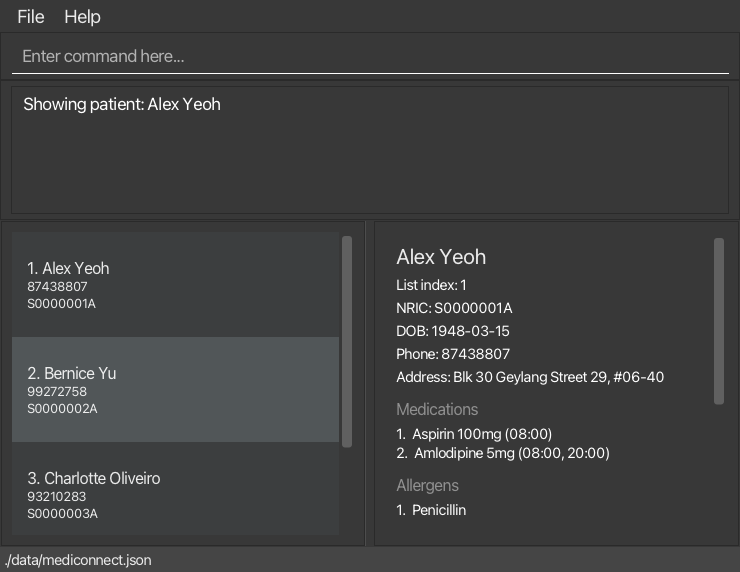
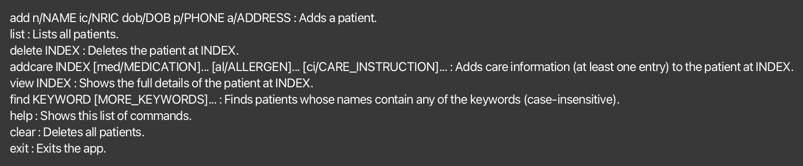
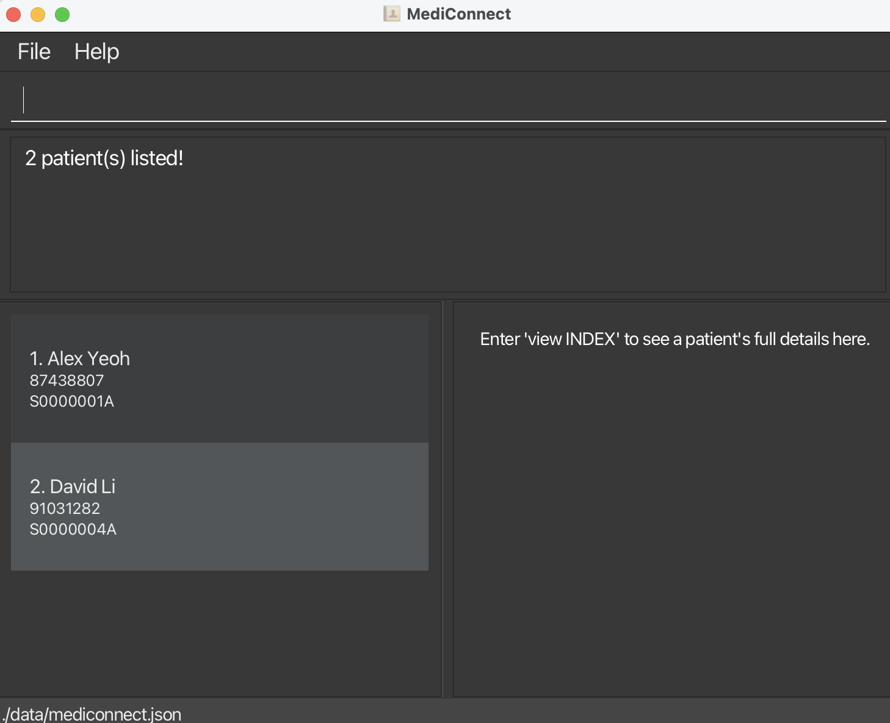

# MediConnect User Guide

MediConnect is a **desktop application for managing patient records and care information, optimized for use through a Command Line Interface (CLI)** while retaining the benefits of a Graphical User Interface (GUI). If you type quickly, MediConnect can help you manage patient records faster than traditional GUI applications.

<!-- * Table of Contents -->
<page-nav-print />

--------------------------------------------------------------------------------------------------------------------

## Quick start

1. Ensure that Java `25` or later is installed on your computer. 
   **Mac users:** Ensure you have the precise JDK version prescribed [here](https://se-education.org/guides/tutorials/javaInstallationMac.html).

1. Download `mediconnect.jar` from the [Releases page](https://github.com/AY2627S1-CS2103T-W08-1/tp/releases).

1. Copy the file to an empty folder. This folder will be the _home folder_ for your MediConnect data.

1. Open a terminal, `cd` to that folder, and run `java -jar mediconnect.jar`. 
   A GUI similar to the one below should appear in a few seconds. On first launch, the patient list is filled with sample patients so you can try out the commands. 
   

1. Type a command in the command box and press Enter to execute it. For example, type **`help`** and press Enter to open the help window. 
   Some example commands you can try, in this order:

   * `list` : Lists all patients.

   * `add n/John Tan ic/S1234567A dob/1990-05-14 p/91234567 a/Blk 123 Clementi Ave 3` : Adds a patient named `John Tan` to MediConnect.

   * `view 1` : Shows the full details of the 1st patient in the current list.

   * `find John` : Lists all patients whose name contains `John`.

   * `delete 1` : Deletes the 1st patient shown in the current list. Right after `find John`, this deletes `John Tan`.

   * `exit` : Exits the app.

1. Refer to the [Features](#features) section below for details of each command.

--------------------------------------------------------------------------------------------------------------------

## Features

<box type="info" seamless>

**Notes about the command format:** 

* Words in `UPPER_CASE` are the parameters to be supplied by the user. 
  For example, in `add n/NAME`, replace `NAME` with a value such as `John Doe`.

* Items in square brackets are optional. 

* Items followed by `...` can appear zero or more times. 

* Parameters can be in any order. 
  For example, if the command specifies `n/NAME p/PHONE_NUMBER`, `p/PHONE_NUMBER n/NAME` is also acceptable.

* Extraneous parameters for commands that take no parameters, such as `help`, `list`, `exit`, `clear` and `backup`, are ignored. 
  For example, `help 123` is interpreted as `help`.

* If you are using a PDF version of this document, be careful when copying and pasting commands that span multiple lines as space characters surrounding line-breaks may be omitted when copied over to the application.
</box>

### Viewing help: `help`

Opens a help window that lists every command with its format and a one-line description.

Format: `help`

* You can also open the help window with the `Help` menu or by pressing `F1`.
* Any text after `help` is ignored. For example, `help add` is interpreted as `help`.
* If the help window is already open, no second help window is opened.

The command returns `Opened help window.`

### Adding a patient: `add`

Adds a patient's basic details to MediConnect, with empty medication, allergen, and care instruction lists.

Format: `add n/NAME ic/NRIC dob/DOB p/PHONE a/ADDRESS`

* All five fields are required and can appear in any order.
* Each prefix must appear only once. Repeated prefixes are rejected, e.g.,
  `Multiple values specified for a single-valued field: n/`.
* Unrecognized letters followed by `/` at the start of a word, such as `x/123`, `med/Aspirin`, or `A/B`, are
  rejected. For example, `x/123` gives `Unrecognized parameter: x/. Please check the command format.`
* Standalone `s/o`, `d/o`, and `c/o` are allowed anywhere in the `add` arguments, ignoring letter case.
  Other field rules still apply. Keep them separate from other text or punctuation: `s/o,` is not allowed.
  For example, `s/o,` gives `Unrecognized word: 's/o,'. Write s/o as a separate word without punctuation.`
  Addresses can include numeric slash text such as `21/3` and URLs.
* `NRIC` must be 1 letter (S, T, F, G, or M), 7 digits, and 1 letter, e.g., `S1234567A`.
  It is not case-sensitive and is stored in uppercase.
* `DOB` must be a valid date in `YYYY-MM-DD` format, e.g., `1950-04-12`, from `1900-01-01` to today.
* Patients with the same NRIC, ignoring letter case, are rejected with
  `This patient (identified by NRIC) already exists in MediConnect.` Names alone do not identify duplicates.
* `NAME` must start with a letter and can only contain letters, spaces, `'`, `-`, `/` and `.`,
  e.g., `Tan Ah Kow s/o Lim` or `Mary-Jane O'Brien`.
  Each `'`, `-` or `/` must be between two letters, and each `.` must come right after a letter.
  A curly apostrophe (`’`) is treated as `'`. Multiple spaces between words are reduced to one.
* `PHONE` must be 8 digits, with an optional `+65` in front, e.g., `91234567` or `+6591234567`.
  It is stored without the `+65`.

Examples:

* `add n/John Tan ic/S1234567A dob/1950-04-12 p/91234567 a/21 Lorong 3, #05-10`
* `add n/Mary Lim ic/S7654321B dob/1945-11-02 p/98765432 a/Blk 12 Ang Mo Kio Ave 4`

The first example returns:
`New patient added: John Tan; NRIC: S1234567A; DOB: 1950-04-12; Phone: 91234567; Address: 21 Lorong 3, #05-10;`

If a required field is missing, the command is rejected with `Invalid command format!` followed by the usage and example.

### Field formats

Field   | Prefix | Format | Example
--------|--------|--------|--------
Name    | `n/`   | Starts with a letter. Only letters, spaces, `'`, `-`, `/` and `.`; `'`, `-` and `/` must be between letters, and `.` must come right after a letter. Multiple spaces between words are reduced to one. | `Mary-Jane O'Brien`
NRIC    | `ic/`  | 1 letter (S, T, F, G or M), 7 digits, 1 letter. Not case-sensitive; stored in uppercase. | `S1234567A`
DOB     | `dob/` | A valid date in `YYYY-MM-DD` format, from `1900-01-01` to today. | `1950-04-12`
Phone   | `p/`   | 8 digits with no spaces, with an optional `+65` in front. Stored without the `+65`. | `91234567`, `+6591234567`
Address | `a/`   | Any value, but not blank. | `Blk 12 Ang Mo Kio Ave 4, #05-10`

Leading and trailing spaces in every field are ignored. A word that looks like an unknown prefix, such as `x/12`, is not allowed in any field (see the `add` command).

### Adding care information: `addcare`

Appends medications, allergens, or care instructions to the patient at the displayed index.
Existing care information is never overwritten.

Format: `addcare INDEX [med/MEDICATION]... [al/ALLERGEN]... [ci/CARE_INSTRUCTION]...`

* `INDEX` follows the same rules as `delete` and refers to the currently displayed patient list.
* At least one `med/`, `al/`, or `ci/` prefix is required. Each prefix can be repeated.
* Care entries are trimmed free text and cannot be blank. If any entry is blank, the whole command is rejected.
* A word that looks like an unrecognized prefix is rejected. For example, `p/91234567` returns
  `Unrecognized parameter: p/. Please check the command format.` Numeric slash text and URLs are allowed.
* Duplicate entries, ignoring letter case and surrounding spaces, are not added again. Other unique entries in the
  same command are still added.
* A medication added with `med/` has no daily times yet.

Examples:

* `addcare 1 med/Metformin 500mg twice daily`
* `addcare 2 al/Penicillin al/Shellfish`
* `addcare 1 ci/Check blood sugar before breakfast`

A successful command returns `Updated care info for NAME. Added: ITEMS.` Each item is labeled by category while
keeping the category and input order, e.g., `Medication: Aspirin, Allergen: Aspirin, Care instruction: Aspirin`.

Each skipped duplicate is named in the feedback. For example:

* An entry already stored for the patient returns
  `Medication "Metformin" was not added: it already exists for this patient.`
* An entry repeated within the same command returns
  `Medication "Aspirin" was not added: it was repeated in this command.`

The same wording is used for allergens and care instructions, with `Allergen` or `Care instruction` in place of
`Medication`. Unique entries in the command are still added. If every supplied entry is a duplicate, the command is
rejected without changing the patient.

Other errors are reported as follows:

* An index outside the displayed list returns `The patient index provided is invalid.`
* A command with no care prefix returns `Please specify at least one of med/, al/, or ci/ to add.`
* A blank value returns `Medication entries cannot be blank.`, `Allergen entries cannot be blank.`, or
  `Care instructions cannot be blank.` for the affected category. The whole command is rejected.
* A missing, zero, negative, non-numeric, or excessively large index returns `Invalid command format!`, followed by
  the command usage.

### Deleting an allergen: `deleteallergy`

Removes one allergen from the patient at `INDEX` in the displayed patient list.

Format: `deleteallergy INDEX ALLERGY_INDEX`

* `ALLERGY_INDEX` is the allergen number shown in that patient's detail panel. Both indices must be positive
  integers.
* The removed allergen is reported in the success message. Remaining allergens are renumbered immediately in the
  detail panel. All other patient details are unchanged.

Example: `deleteallergy 1 2`

For patient `Alex Yeoh`, if allergen 2 is `Shellfish`, this returns
`Deleted allergen for Alex Yeoh: Shellfish`.

An `INDEX` outside the displayed patient list returns `The patient index provided is invalid.` An
`ALLERGY_INDEX` past the end of the patient's allergens, including when none are recorded, returns
`The allergen index provided is invalid.` Missing, zero, negative, nonnumeric or extra indices return
`Invalid command format!` followed by the command usage. Validation failures leave patient data unchanged.

### Adding a contact: `addcontact`

Adds one contact to the patient at `INDEX` in the displayed patient list.

Format: `addcontact INDEX n/NAME r/ROLE p/PHONE [nt/NOTE]`

* Name, role and phone are required. Each prefix can appear only once; fields can appear in any order.
* Names are nonblank free text, so both people and organisations such as `Tan & Partners Clinic` are supported.
  Leading/trailing whitespace is removed and repeated spaces in a name become one.
* Role is nonblank free text. Examples include `GP`, `specialist`, `pharmacist`, `emergency` and `guardian`;
  other roles are allowed.
* Contact phones can contain digits, spaces, `+` and `-`, with at least three digits. They use different rules
  from patient phones so overseas and clinic numbers are supported. Formatting is preserved after trimming.
* The note is optional. An omitted or empty `nt/` creates a contact without a note.
  Surrounding spaces are removed from notes entered through commands.
* A contact with the same name (ignoring case and repeated spaces) and phone (ignoring spaces and hyphens)
  already on this patient is rejected. Role and note do not distinguish duplicates. `+` remains significant;
  country codes are not inferred. The same contact can belong to different patients.
* Unknown prefixes and repeated prefixes are rejected. Words starting with unrecognised letters followed by `/`,
  including standalone `s/o`, `d/o` and `c/o`, are rejected.
  Text matching a recognised prefix after a space starts another field, even inside a note.
* Contacts appear in insertion order, numbered in the `view` panel. If that patient is already viewed,
  the panel updates immediately. Existing care information is preserved.

Example: `addcontact 1 n/Lim & Partners Clinic r/GP p/+65 6123-4567 nt/Call in the morning`

For patient `Alex Yeoh`, this returns:
`Added contact for Alex Yeoh: Lim & Partners Clinic (GP); Phone: +65 6123-4567; Note: Call in the morning`

Blank names/roles return `Contact name cannot be blank.` or `Contact role cannot be blank.`
An invalid phone returns `Contact phone must contain at least 3 digits and only digits, spaces, + and -.`
A duplicate returns `This contact (identified by name and phone) already exists.` No contact is added on failure.

### Editing a contact: `editcontact`

Format: `editcontact INDEX CONTACT_INDEX [n/NAME] [r/ROLE] [p/PHONE] [nt/NOTE]`

* `INDEX` is the patient's index in the displayed list; `CONTACT_INDEX` is its contact number in the detail panel.
  Both indices must be positive integers.
* Supply at least one field. Omitted fields keep their values; `nt/` with no value clears the note.
* The same field and duplicate rules as `addcontact` apply. An edit that creates a duplicate is rejected.
  Editing a contact to its existing values is allowed. Its list position stays the same.
* With no fields, the error is `Specify at least one contact field to edit.`

Example: `editcontact 1 1 nt/Call after lunch`

Success begins with `Updated contact for NAME:` followed by the updated contact's name, role, phone and any note.

### Deleting a contact: `deletecontact`

Format: `deletecontact INDEX CONTACT_INDEX`

Removes that contact and reports `Deleted contact for NAME:` followed by the removed contact's details.
Remaining contacts are renumbered. Other patient details are unchanged.

Example: `deletecontact 1 2`

For all three contact commands, `INDEX` must refer to a patient in the displayed list; otherwise the error is
`The patient index provided is invalid.` A contact number past the end, including when there are no contacts,
returns `The contact index provided is invalid.` Missing, zero, negative, nonnumeric or extra indices give the
command's usage. Validation failures leave patient data unchanged.

### Listing all patients: `list`

Shows a list of all patients in MediConnect.

Format: `list`

### Editing a patient: `edit`

Not implemented in the MVP. The command returns `Edit command is not implemented yet.` without changing patient data.

### Locating patients by name: `find`

Finds patients whose names contain any of the given keywords.

Format: `find KEYWORD [MORE_KEYWORDS]`

* The search is case-insensitive; for example, `alex` matches `Alex`.
* Keyword order does not matter; for example, `Alex David` matches `David Alex`.
* The search considers only names.
* Only full words match; for example, `Ale` does not match `Alex`.
* Patients matching at least one keyword are returned (an `OR` search); for example, `Alex David` returns `Alex Yeoh` and `David Li`.

Examples:
* `find Bernice` returns `Bernice Yu`
* `find alex david` returns `Alex Yeoh`, `David Li` 
  

### Deleting a patient: `delete`

Deletes the specified patient from MediConnect.

Format: `delete INDEX`

* Deletes the patient at the specified `INDEX`.
* The index refers to the index number shown in the displayed patient list.
* The index **must be a positive integer** 1, 2, 3, ...

Examples:
* `list` followed by `delete 2` deletes the 2nd patient in MediConnect.
* `find Alex` followed by `delete 1` deletes the 1st patient in the results of the `find` command.

### Viewing a patient's full details: `view`

Shows all the details of the specified patient in the panel to the right of the patient list.

Format: `view INDEX`

* Shows the patient at the specified `INDEX`, which refers to the index number shown in the displayed patient list.
* The index **must be a positive integer** 1, 2, 3, ...
* The panel shows the patient's name, NRIC, date of birth, phone number, and address, followed by their
  medications, allergens, care instructions and contacts. Each list is numbered (`1.`, `2.`, ...), one entry per line.
  A medication with daily times shows them after its description, e.g., `Metformin 500mg (08:00, 20:00)`.
  An empty list shows `None recorded`.
* Before any patient is viewed, the panel shows `Enter 'view INDEX' to see a patient's full details here.`
* The panel keeps showing the patient after other commands, such as `list` or `find`, even if `find` hides the
  patient from the list. It updates when the patient's care information changes, e.g., after `addcare`, and goes back
  to the message above when the patient is deleted or all patients are cleared.

Examples:

* `list` followed by `view 2` shows the details of the 2nd patient in the list.
* `find Bernice` followed by `view 1` shows the details of the 1st patient in the results of the `find` command.

A successful command returns `Showing patient: NAME`, e.g., `Showing patient: Bernice Yu`.

If `INDEX` is larger than the number of patients in the displayed list, the command is rejected with
`The patient index provided is invalid.` If `INDEX` is missing, is not a positive integer (e.g., `0`, `-1`, or `abc`),
is too large to be a valid number (e.g., `99999999999`), or is followed by extra words, the command is rejected with
`Invalid command format!` followed by the usage and example. In both cases, the panel keeps showing the patient it
showed before.

### Listing today's medication times: `due`

Lists the times at which medications are taken today, one line per dose, in the order they are due.

Format: `due [INDEX]`

* Without `INDEX`, `due` lists the doses of **all** patients in MediConnect, even if `find` is hiding some of them
  from the patient list.
* With `INDEX`, `due` lists only the doses of the patient at that index in the displayed patient list. `INDEX` is
  the number of the patient in the currently displayed patient list, as for `delete`. It must be a positive whole
  number (1, 2, 3, ...).
* Each line has the form `HH:MM PATIENT_NAME: DESCRIPTION`, e.g., `08:00 Alex Yeoh: Aspirin 100mg`. A medication
  with several times has one line for each time.
* Lines are sorted by time, earliest first, and then by patient name, ignoring letter case. Doses of the same
  patient at the same time are listed in the order of the patient's medications.
* A time that is earlier than the current time of your computer (in its time zone) is followed by
  ` (earlier today)`. A time in the current minute is not marked. Every time is a daily time, so the same times
  are listed each day.
* Medications without times are not listed.
* The result is shown in the result box. The patient list and the details panel are not changed, and no data is
  changed.

Examples (each one run on the sample data at 10:30, where patient 1 is Alex Yeoh with `1. Aspirin 100mg (08:00)` and
`2. Amlodipine 5mg (08:00, 20:00)`, and the other patients have no times):

* `due` returns 
  `08:00 Alex Yeoh: Aspirin 100mg (earlier today)` 
  `08:00 Alex Yeoh: Amlodipine 5mg (earlier today)` 
  `20:00 Alex Yeoh: Amlodipine 5mg`
* `due 1` returns the same three lines, because only Alex Yeoh has times.
* `due 2` returns `No medications are due today for Bernice Yu.`

Run before 08:00, the same `due` returns the three lines without ` (earlier today)`.

If there is nothing to list, `due` returns `No medications are due today.` and `due INDEX` returns
`No medications are due today for PATIENT_NAME.`

Errors are reported as follows:

* An `INDEX` outside the displayed list returns `The patient index provided is invalid.`
* A zero, negative, non-numeric, or excessively large `INDEX`, or anything after `due` other than a single
  number (e.g., `due 1 2`), returns `Invalid command format!`, followed by the command usage.

### Clearing all patients: `clear`

Clears all patients and their care information from MediConnect, and clears any patient details in the view panel.

Format: `clear`

Returns `All patients have been cleared.`, including when there are no patients to clear.

### Backing up data: `backup`

Saves a copy of all patient data to the `data/backups` folder, inside the folder you launch MediConnect from. MediConnect creates the folder if it does not exist yet.

Format: `backup`

* The backup is named after the date and time it was made, as `mediconnect-YYYYMMDD-HHMMSS.json` (e.g., `mediconnect-20261020-083015.json` for 20 Oct 2026, 8:30:15 am).
* If you make more than one backup within the same second, MediConnect adds `-1`, `-2` and so on to the name, so no backup is overwritten.
* Any text after `backup` is ignored. For example, `backup now` is interpreted as `backup`.

Returns `Backup saved to: ` followed by the full path of the backup file.

If the backup cannot be saved (e.g., the folder is read-only), MediConnect shows `Could not save the backup to ` followed by the folder and the reason, and your data is not changed.

<box type="warning" seamless>

**Caution:**
`backup` saves the patient data currently loaded in MediConnect. If MediConnect started with no patients because `data/mediconnect.json` could not be loaded, a backup made then has no patients. Your original data is in the recovery copy named in the startup warning. To recover it, see [Editing the data file](#editing-the-data-file).
</box>

<box type="tip" seamless>

**Tip:** Run `backup` before editing the data file by hand or before making many changes at once. To go back to a backup later, use `restore`.
</box>

### Restoring data from a backup: `restore`

Replaces all patient data with the data in a backup file from the `data/backups` folder.

Format: `restore FILENAME`

* `FILENAME` is the name of a file in `data/backups`, such as one made by `backup`. Give only the file name, not a path, e.g., `mediconnect-20261020-083015.json` rather than `data/backups/mediconnect-20261020-083015.json`.
* MediConnect checks the whole backup before changing anything. If the file is missing, cannot be read, or has invalid data, MediConnect says what is wrong and your data is not changed.
* Before replacing your data, MediConnect backs up your current data to `data/backups`, the same way `backup` does. If that backup cannot be saved, nothing is restored. To undo a restore, restore that backup.
* MediConnect never deletes backups, including the automatic ones. You can delete old files in `data/backups` by hand when you no longer need them.
* After a restore, the list shows all restored patients. The view panel is cleared, unless the patient shown there is also in the backup with the same details.

Examples:
* `restore mediconnect-20261020-083015.json` replaces your data with the backup made at 8:30:15 am on 20 Oct 2026.

Returns, for example, `Restored 7 patients from mediconnect-20261020-083015.json. Your previous data was backed up to: ` followed by the full path of the automatic backup.

### Exiting the program: `exit`

Exits the program.

Format: `exit`

### Saving the data

MediConnect automatically saves data after every command. You do not need to save manually.

### Editing the data file

MediConnect data is saved automatically as a JSON file `data/mediconnect.json`, inside the folder you launch MediConnect from. Advanced users are welcome to update data directly by editing that data file.

<box type="warning" seamless>

**Caution:**
If the data file cannot be loaded, MediConnect first saves an unchanged recovery copy beside it, named
`mediconnect-unreadable-<unique ID>.json`, then starts with no patients. A warning shows the recovery copy's full
path. Commands continue to save to `data/mediconnect.json`; the recovery copy is kept separately.
If the recovery copy cannot be created, startup stops so the original file is not overwritten.
To recover your data, close MediConnect, repair a copy of the recovery file and replace `data/mediconnect.json`
with the repaired file before restarting. Keep the recovery copy until you have checked the recovered patients.
We still recommend backing up the file before editing it. 
Furthermore, certain edits can cause MediConnect to behave in unexpected ways (e.g., if a value entered is outside of the acceptable range). Therefore, edit the data file only if you are confident that you can update it correctly.
</box>

--------------------------------------------------------------------------------------------------------------------

## FAQ

**Q**: Where is my data saved? 
**A**: In `data/mediconnect.json`, inside the folder you launch MediConnect from. If this file does not exist, MediConnect creates it with sample patients when it starts. After that, it saves to the file after every command.

**Q**: How do I transfer my data to another computer? 
**A**: Install the app on the other computer and overwrite the data file it creates with the data file from your previous MediConnect home folder.

--------------------------------------------------------------------------------------------------------------------

## Known issues

1. **When using multiple screens**, if you move the application to a secondary screen, and later switch to using only the primary screen, the GUI will open off-screen. The remedy is to delete the `preferences.json` file created by the application before running the application again.
2. **If you minimize the Help Window** and then run the `help` command (or use the `Help` menu, or the keyboard shortcut `F1`) again, the original Help Window will remain minimized, and no new Help Window will appear. The remedy is to manually restore the minimized Help Window.

--------------------------------------------------------------------------------------------------------------------

## Command summary

Action            | Format, Examples
------------------|------------------------------------------------------------------------------------------------------------------
**Add**           | `add n/NAME ic/NRIC dob/DOB p/PHONE a/ADDRESS`   e.g., `add n/John Tan ic/S1234567A dob/1950-04-12 p/91234567 a/21 Lorong 3, #05-10`
**Add care info** | `addcare INDEX [med/MEDICATION]... [al/ALLERGEN]... [ci/CARE_INSTRUCTION]...`   e.g., `addcare 1 med/Paracetamol 500mg al/Latex ci/Turn every 2 hours`
**Delete allergen** | `deleteallergy INDEX ALLERGY_INDEX`   e.g., `deleteallergy 1 2`
**Add contact** | `addcontact INDEX n/NAME r/ROLE p/PHONE [nt/NOTE]`   e.g., `addcontact 1 n/Dr Tan r/GP p/+65 6123-4567`
**Edit contact** | `editcontact INDEX CONTACT_INDEX [n/NAME] [r/ROLE] [p/PHONE] [nt/NOTE]`   e.g., `editcontact 1 1 nt/Call first`
**Delete contact** | `deletecontact INDEX CONTACT_INDEX`   e.g., `deletecontact 1 2`
**Backup**        | `backup`
**Clear**         | `clear`
**Delete**        | `delete INDEX`   e.g., `delete 3`
**Due**           | `due [INDEX]`   e.g., `due`, `due 1`
**Exit**          | `exit`
**Find**          | `find KEYWORD [MORE_KEYWORDS]...`   e.g., `find Alex Bernice`
**Help**          | `help`
**List**          | `list`
**Restore**       | `restore FILENAME`   e.g., `restore mediconnect-20261020-083015.json`
**View**          | `view INDEX`   e.g., `view 2`
